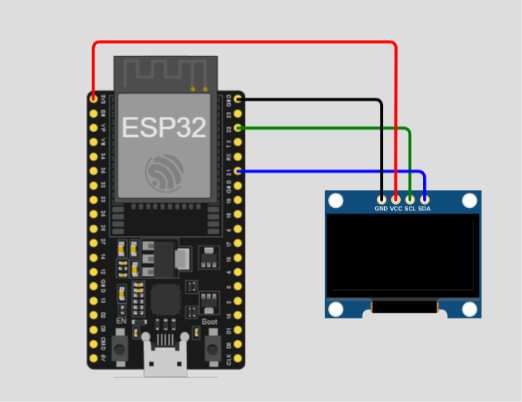

# SongoltNom OLED

ESP32 болон SSD1309 128×64 I2C OLED дэлгэц дээр Монгол текстийг хөдөлгөөнтэй харуулах Arduino төсөл.

Текст үсэг үсгээр гарч, мөрүүд гулсаж байрлан, пикселүүд шатлалтай арилна. Дэлгэцийн булангийн хүрээ болон анивчих одод текстийн хөдөлгөөнтэй хамт харагдана.

## Demo

[OLED-ийн demo бичлэг үзэх / татах](docs/videos/demo.mp4)

## Шаардлагатай хэрэгсэл

- ESP32 development board. Board-ийн яг загвар, туршсан хувилбарыг доорх хүснэгтэд нөхнө.
- SSD1309 controller бүхий 128×64 I2C OLED module.
- USB data cable болон холболтын утаснууд.
- Arduino IDE, ESP32 board package, U8g2 library.

## Холболт

Тэжээлийг салгасан үедээ холбоно. OLED module-ийн pin тэмдэглэгээ болон тэжээлийн шаардлагыг шалгана.

| OLED | ESP32 | Тайлбар |
| --- | --- | --- |
| SDA | GPIO21 | Кодын `SDA_PIN` |
| SCL | GPIO22 | Кодын `SCL_PIN` |
| GND | GND | Нийтлэг газардуулга |
| VCC | Module-ийн шаардлагад тохирсон тэжээл | Module-ийн datasheet-ээс шалгана |

ESP32-ийн I2C дохионы түвшин 3.3 V байна. Өөр board ашиглавал GPIO21/22 байгаа эсэх, I2C-д ашиглаж болох эсэхийг шалгаж кодын pin-үүдийг тохируулна.



## Суулгах, ажиллуулах

1. Arduino IDE суулгана.
2. Boards Manager-ээр `esp32` by Espressif Systems package суулгана. Хэрэв хайлтад харагдахгүй бол IDE-ийн Preferences дахь Additional Boards Manager URLs хэсэгт `https://espressif.github.io/arduino-esp32/package_esp32_index.json` нэмнэ.
3. Library Manager-ээс `U8g2` by oliver суулгана. `Arduino.h`, `Wire.h` нь board package-тай хамт ирнэ.
4. `SongoltNom_oled/SongoltNom_oled.ino` файлыг Arduino IDE-д нээнэ.
5. USB-ээр ESP32-оо холбоод **Tools → Board**, **Tools → Port** хэсгээс бодит board болон port-оо сонгоно.
6. **Verify** хийж compile амжилттай болсны дараа **Upload** дарна.
7. Serial Monitor-оо **115200 baud** дээр нээж, шаардлагатай бол ESP32-ийн Reset товчийг дарна.

OLED илэрвэл Serial Monitor дээр `OLED I2C address: 0x3C` эсвэл `0x3D` гарна. Эхний 2 секундэд чимэглэл харагдаж, дараа нь текстийн дараалал эхэлнэ. Сүүлийн «Зүгээр л / МЭДРЭХ» текст дэлгэц дээр үлдэнэ. Дахин эхлүүлэхийн тулд Reset дарна.

## Текст болон хөдөлгөөн тохируулах

Бүх тохиргоо `SongoltNom_oled/SongoltNom_oled.ino` файлд байна. Файлыг UTF-8 encoding-оор хадгална.

| Тохиргоо | Одоогийн утга | Зориулалт |
| --- | --- | --- |
| `TITLE1` … `TITLE10_BOTTOM` | Монгол текстүүд | Дэлгэцийн үг, өгүүлбэрүүд |
| `START_DELAY_MS` | `2000` | Текст эхлэхийн өмнөх завсар |
| `TYPE_MS` | `110` | Үсэг бүр гарах хоорондох хугацаа |
| `SLIDE_MS` | `1200` | Мөр гулсах хугацаа |
| `FADE_MS` | `700` | Текст бүдгэрч арилах хугацаа |
| `ANIM_FRAME_MS` | `20` | Кадр шинэчлэх зорилтот зай |

Хугацааны утгууд миллисекундээр өгөгдөнө. Зарим хэсэг өөрийн тусгай хугацаатай; жишээлбэл есдүгээр текст `NINTH_TYPE_MS` ашигладаг. Урт текст нэмбэл 128×64 дэлгэцийн багтаамж болон сонгосон font-д багтаж буй эсэхийг төхөөрөмж дээр шалгана.

## Алдаа оношлох

| Шинж тэмдэг | Шалгах зүйл |
| --- | --- |
| `U8g2lib.h: No such file or directory` | Library Manager-ээс U8g2 суулгасан эсэх |
| Serial Monitor дээр `OLED олдсонгүй` | Тэжээл, GND, SDA/SCL болон module-ийн I2C горим. Код зөвхөн `0x3C`, `0x3D` хаягийг шалгана |
| I2C хаяг илэрсэн ч дэлгэц хоосон | Бодит controller SSD1309 мөн эсэх, 128×64 хэмжээ болон U8g2 constructor таарч буй эсэх |
| Монгол үсэг дутуу эсвэл буруу | Файлын UTF-8 encoding, `u8g2_font_cu12_t_cyrillic` font тухайн тэмдэгтийг дэмжиж буй эсэх |
| Upload амжилтгүй | Сонгосон board/port, USB data cable, port ашиглаж байгаа бусад програм |

## Төслийн бүтэц

```text
.
├── README.md
├── LICENSE
├── .gitignore
├── docs/
│   ├── images/
│   │    └── wiring.png
│   └── videos/
│        └── demo.mp4
└── SongoltNom_oled/
    └── SongoltNom_oled.ino
```

## Туршилтын төлөв

Баримтжуулалтыг одоогийн кодод тулгуурлан бэлтгэсэн. Энэ баримтжуулалтыг нэмэх үед compile болон төхөөрөмж дээрх туршилт хийгээгүй.

| Үзүүлэлт | Туршсаны дараа нөхөх мэдээлэл |
| --- | --- |
| ESP32 board | Яг загвар |
| OLED module | Загвар, тэжээлийн хүчдэл |
| Arduino IDE | Хувилбар |
| ESP32 board package | Хувилбар |
| U8g2 | Хувилбар |
| Үр дүн | Compile, upload, Монгол үсэг, бүтэн хөдөлгөөний дараалал |

## Лиценз

Энэ төсөл [MIT лицензтэй](LICENSE).
